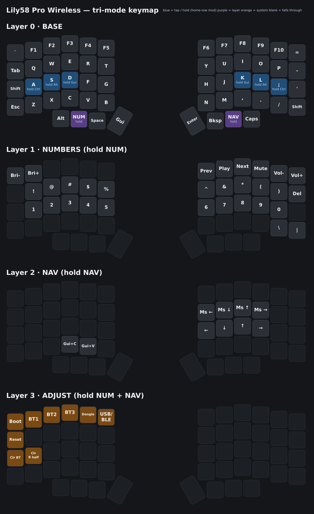

# Lily58 Pro Wireless — tri-mode (RMK + Vial)

- **Left half** = runs the keymap and Vial. Connects to the PC three ways: through the **dongle**, over **Bluetooth** directly, or over **USB** with a cable in the left half.
- **Right half** = connects to the left half over BLE.
- **Dongle** (3rd nice!nano + 1.3" SH1106 OLED) = USB receiver plus status screen. It has no keymap of its own.
- 56 keys (the inner key under each nice!nano isn't used).

## Keymap

This is the default keymap built into the firmware (from [`keyboard.toml`](keyboard.toml)). Changes you make in Vial aren't shown.

## Firmware

The firmware is built by GitHub Actions. Open the **Actions** tab, open the latest run on this branch, and download the `firmware` artifact.

| File | Flash to |
| --- | --- |
| `lily58_left.uf2` | left half |
| `lily58_right.uf2` | right half |
| `lily58_dongle.uf2` | dongle |
| `*_reset.uf2` | clears saved settings (keymap / pairings) for that board |

The dongle firmware is in [`dongle/`](dongle/). The keymap is in [`keyboard.toml`](keyboard.toml).

## First flash

For each board: plug it in, double-tap reset so the `NICENANO` drive appears, then drag the file onto it.

1. Left half: `lily58_left_reset.uf2`, then `lily58_left.uf2`.
2. Right half: `lily58_right_reset.uf2`, then `lily58_right.uf2`.
3. Dongle: `lily58_dongle_reset.uf2`, then `lily58_dongle.uf2`.
4. Switch both halves on. They find each other by themselves.
5. Pair the dongle: plug it into the PC, then press **Adjust + DONGLE** (hold both layer keys, then the 5th key of the top row). The OLED switches from SEARCHING to the layer screen.

## Switching between dongle, Bluetooth and USB

Hold **both layer keys** (Adjust: the 2nd left thumb key + the 3rd right thumb key), then use the top row of the left half:

| Key | Does |
| --- | --- |
| 2nd key (BT1) | use Bluetooth slot 1 — hold 5 s to pair a new device |
| 3rd key (BT2) | Bluetooth slot 2 |
| 4th key (BT3) | Bluetooth slot 3 |
| 5th key (DONGLE) | use the dongle — hold 5 s to pair a different dongle |
| 6th key (USB/BLE) | toggle wired USB vs wireless while a cable is plugged into the left half |

To pair a phone or laptop: press a BT key, then pick **Lily58 Pro** in that device's Bluetooth settings.

## Bootloader without opening the case

| Board | How |
| --- | --- |
| Left half | Adjust + top-left key, or hold the **top-left key** (`` ` ``) while switching it on |
| Right half | Hold the **top-right key** (=) while switching it on or plugging in USB |
| Dongle | Double-tap its reset button |

## Other Adjust keys

- 2nd row, left: reboot the left half
- 3rd row, 1st key: clear the current Bluetooth slot
- 3rd row, 2nd key: **hold 5 s** to forget the right half, then power-cycle both halves to re-pair

## Changing the keymap

- **Live:** open [Vial](https://get.vial.today/) with the dongle plugged in (or over USB to the left half). No unlock combo is needed. Changes are saved on the left half.
- **Default keymap:** edit `keyboard.toml` and push.

## OLED

The screen layout is in [`dongle/src/renderer.rs`](dongle/src/renderer.rs): WPM (and CAPS), the current layer, and battery bars for both halves. It shows SEARCHING when the keyboard isn't using the dongle, and blanks while the keyboard sleeps (after 10 minutes idle).

OLED wiring on the dongle: GND→GND, VCC→VCC, SDA→D2 (P0.17), SCL→D3 (P0.20).
